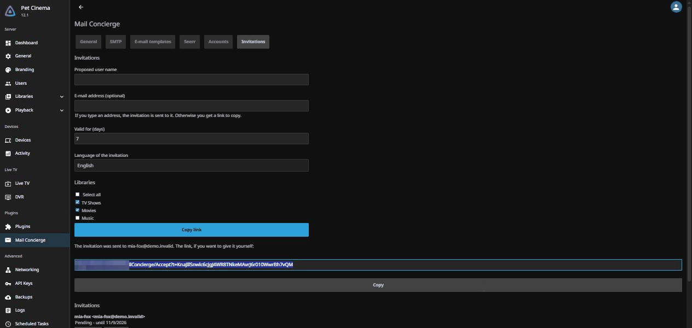

# Changelog

## 12.4.0.0

Welcome to release 12.4.0.0 of **Mail Concierge**. This one lines the plugin up with Jellyfin 12.4, lets people sign in with their e-mail address, and closes a long list of gaps found in a security review.

> [!IMPORTANT]
> This release is for Jellyfin 12.4 and later 12.x (tested on 12.4 only). Jellyfin 12.1 to 12.3 stay on 12.0.0.0, which remains available in the catalogue.

### Highlights

- Sign in with your e-mail address (off by default)
- "Forgot password" accepts the e-mail address too
- Invitation history, with an Erase button on every line
- A tidier settings page
- A security review, and everything it found

### Sign in with your e-mail address

Users can type the confirmed e-mail address of their account in place of the user name, in the web client and in every other app, since the sign-in request is the same. It is **off by default**: tick the option in the settings. The address is swapped for the user name before Jellyfin checks the password, so passwords, sessions and lockout stay Jellyfin's own. Mail Concierge never sees the password and keeps no counter.

Limits, by design:

- One account per address: an address confirmed on several accounts cannot be used to sign in, and the settings tell you how many there are and which accounts share them (user names only, never the addresses).
- Only local Jellyfin accounts: LDAP/SSO accounts and disabled accounts are left out.
- Administrators are left out unless you tick the existing option that also allows them to reset their password by e-mail.
- The user name always wins: text that is already a user name is never read as an address.
- Sign-in by address stops being offered once the account has 3 failed sign-ins, whether they were typed with the address or the user name, and earlier when the account's lockout threshold is low: it is never offered when one more failure would reach the threshold. It comes back after a successful sign-in by user name. The user name keeps working.
- A failed sign-in by address gives the same answer as an unknown user, never earlier than a fixed minimum time, so it does not reveal whether an address is known.

> [!NOTE]
> Native apps keep their "User" label on the sign-in screen; the web client shows "User name or e-mail". Throttling or banning sign-in attempts is still not Mail Concierge's job: see the [security model](https://github.com/vertige-ops/jellyfin-plugin-mail-concierge/blob/main/docs/security-model.md).

### Forgot password, by address too

"Forgot password" also accepts the confirmed e-mail address of the account, in place of the user name; an address shared by several accounts does not work there (the user name does).

### Invitation history

The Invitations tab lists the invitation history, and every line, whatever its state, has an Erase button: it removes the invitation and stops its link, and never touches the account that was created from it.

### A tidier settings page

The General settings are reordered (public URL first), the e-mail language is now in the Templates tab, and the forgot-password switch is reworded: "Do not use Mail Concierge for Forgot password". A button clears the stored SMTP password.

### Upgrade notes

- Install 12.4.0.0 on Jellyfin 12.4 and later 12.x (tested on 12.4 only), then restart Jellyfin. Sign-in by e-mail stays off until you tick it.
- Accounts that already exist keep their own lockout threshold; only accounts created from an invitation after the upgrade get the new value of 5.
- Users who want to sign in by address need a confirmed address in their profile.

### What's changed

#### 🚀 Features

- Sign in with the confirmed e-mail address of the account, off by default.
- "Forgot password" accepts the confirmed e-mail address in place of the user name.
- Invitation history with an Erase button on every line.
- The settings name the accounts that share a confirmed address (user names only, never the addresses).
- A button clears the stored SMTP password.

#### 🌟 Enhancements

- The General settings are reordered, the e-mail language moves to the Templates tab, and the forgot-password switch is reworded.
- Invited accounts are locked out after 5 wrong passwords (instead of 3) and cannot manage live TV. User names chosen on the invitation page can no longer contain `@`; accounts created by an administrator, or older ones, may still contain one, and a user name always wins over an address.
- User names chosen on the invitation page are limited to 64 characters and cannot contain invisible characters.
- The SMTP user name is trimmed.
- One attempt to deliver an e-mail is limited to 2 minutes.

#### 🔒 Security

- The enable switch and the proxy guard now cover every public page and sending path: invitations and e-mail changes as well as recovery, and sign-in by e-mail address. While the service is closed, no token is consumed and no invitation, recovery or e-mail change message is started; messages already queued are still delivered, and the administrator's test e-mail still works.
- The e-mail sending queue is bounded: when it is full, new messages are refused instead of piling up in memory.
- Public pages (reset, confirm, cancel, accept) are limited to 30 views per five minutes and per client address.
- The hourly e-mail limits keep holding when requests come from a very large number of client addresses.
- A failed sign-in by e-mail address is answered at the same minimum time whatever the failure.
- The password checks of the forms can no longer lock an account on their own; a wrong password typed on Jellyfin's own sign-in at the same moment can still add the last failure.
- The tokens of a new invited account are revoked before the account is enabled.
- A recovery e-mail requested at the very moment an address is changed can no longer go to the previous address.
- Profile pictures: the JPEG check now reads every segment before the image data, so a second or malformed header can no longer slip through.
- Seerr: the size of its responses is capped and each request has a single time limit.
- The Seerr import only stores the addresses shown in the preview, starts with every row unticked, warns that imported addresses count as confirmed, and gives up on a Seerr that returns too many users or answers too slowly.
- A proxy on the shared range 100.64.0.0/10 is now seen, and public page views are watched by the proxy guard too.
- The SMTP password and the Seerr API key are asked for again when their server changes. The SMTP password is also asked for again when encryption is turned off.

#### 🐛 Bug fixes

- "Regenerate" on an invitation sends the e-mail again when the invitation has an address.
- The e-mail change form no longer says the message was sent when it could not be queued.
- The settings tab that is open is the one highlighted, also when the page is opened from the invite icon of the Users page.

#### 📦 Build and release

- The release workflow checks that the manifest only adds the release being published.
- The release workflow builds without write access, checks the dependencies of the build tool by hash, and never replaces an already published release.

### That's all for this one

Questions, ideas and bug reports are welcome in the [issues](https://github.com/vertige-ops/jellyfin-plugin-mail-concierge/issues). The known limits are listed openly in the [security model](https://github.com/vertige-ops/jellyfin-plugin-mail-concierge/blob/main/docs/security-model.md).

  

## 12.0.0.0

Welcome to the first public release of **Mail Concierge**, a Jellyfin plugin that puts e-mail in charge of getting people in and getting them back in. It needs Jellyfin 12.1 and changes nothing in Jellyfin itself.

Questions, ideas and bug reports are welcome in the [issues](https://github.com/vertige-ops/jellyfin-plugin-mail-concierge/issues).

### Highlights

- Invite people by e-mail or with a link, with a choice of libraries, validity and language
- "Forgot password" that really sends an e-mail: a PIN and a single-use link
- E-mail address in the user profile, confirmed before it is used
- Optional one-way copy of confirmed addresses to Seerr
- Rate limits, hashed single-use tokens and a strict policy on the public pages
- English, French, Spanish and German

### Invitations

Administrators invite someone from the Invitations tab, or from the invite button next to the + of the user list. The invitation goes by e-mail or as a link to copy. You pick the libraries (with "select all"), how long it stays valid and the language of the message. The invitee chooses their own user name and password on a public page and may add a profile picture. Invited accounts are never administrators.

### Password recovery

The native "Forgot password" button now sends an e-mail with a PIN, for the page that is already open, and a single-use link. The PIN never becomes the password. The answer looks the same, in shape and in timing, whether the account exists or has an address. After a reset you decide what happens to open sessions: none, all, or those inactive for N days.

> [!NOTE]
> Use the assignment button in the settings to give the Mail Concierge reset provider to existing users. Administrators are left out unless you tick the option, and LDAP/SSO accounts are always left out. A setting brings back the native Jellyfin behavior.

### E-mail in the profile and Seerr

Users set their address themselves, with a confirmation e-mail and their current password. The old address receives a warning with a cancel link, valid 24 hours by default, that also asks for the password. Administrators can set an address for anyone. If you use Seerr, confirmed addresses can be copied one way to the matching Seerr account, with a preview first.

### Safety by design

Per-account, per-IP and per-kind e-mail limits, PIN brute-force protection, tokens stored hashed and consumed only when a form is submitted (so a mail scanner cannot burn your link), profile pictures checked on the server, strict address validation, and no activation behind an undeclared reverse proxy. The known limits are listed openly in the [security model](https://github.com/vertige-ops/jellyfin-plugin-mail-concierge/blob/main/docs/security-model.md).

### Before you start

- Set the **public URL** of your server in the settings: no e-mail is sent until it is set.
- Add your SMTP account and press the test e-mail button.
- Behind a reverse proxy, declare it in Jellyfin under **Known Proxies**.
- Install from the repository URL given in the [README](https://github.com/vertige-ops/jellyfin-plugin-mail-concierge#installation), then restart Jellyfin.

### Good to know

- The Spanish and German texts have not been reviewed by native speakers yet; English is the fallback for any other language.
- The logo at the top of e-mails is loaded from your public URL; without one, no image is shown.
- Native clients (Swiftfin, Android TV...) have no "Forgot password" screen or e-mail field, so they are out of scope.

### What's included

- **Features:** invitations, password recovery, profile e-mail, optional Seerr copy.
- **Settings page:** tabs (General, SMTP, E-mail templates, Seerr, Accounts, Invitations), each with its own Save button, help tooltips, a test e-mail button, editable templates, and warnings for an insecure SMTP mode or an `http://` public URL.
- **Look:** a butler logo on the public pages and in the e-mails, and a plugin image in the catalog.
- **Packaging:** built with jprm for the Jellyfin plugin repository format.

Thank you for trying it, and enjoy a Jellyfin that remembers how to say hello.
