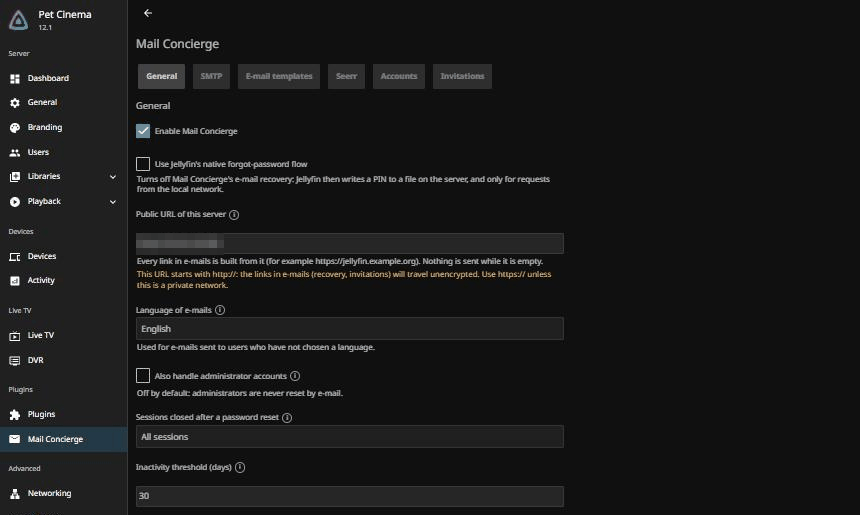
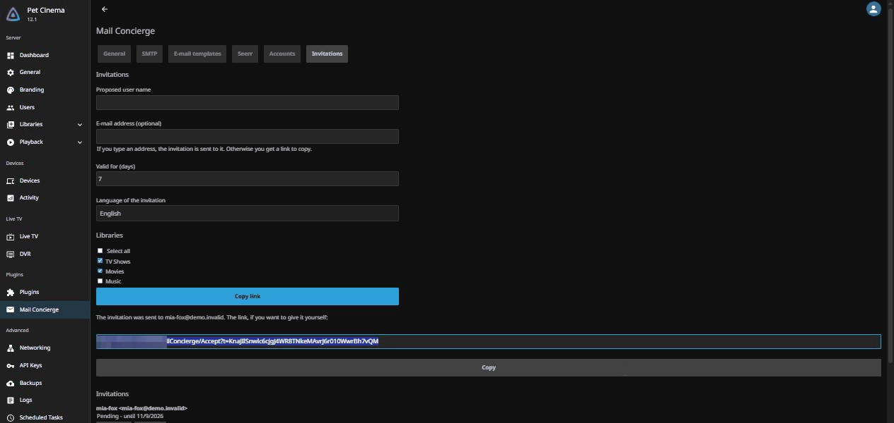
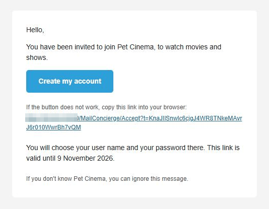
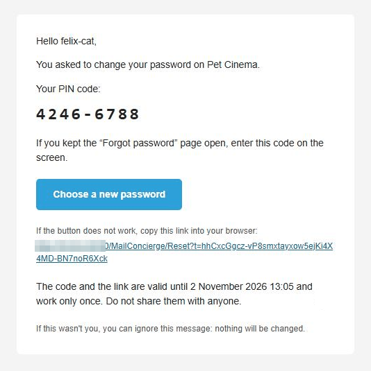
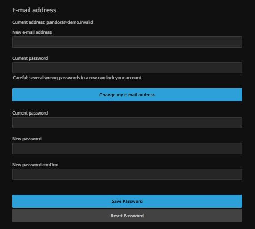

<p align="center"></p>

# Mail Concierge

A Jellyfin 12.1 plugin that adds e-mail invitations and e-mail password recovery, without patching Jellyfin. E-mail is the only channel: there is no SMS, chat or push notification, and none is planned.

- **Invitations**: an administrator invites someone (with an optional e-mail address, libraries and validity). The invitee creates their own account on a public Mail Concierge page. Invited accounts are never administrators.
- **Password recovery by e-mail**: the native "Forgot password" button sends a PIN and a single-use link by e-mail. The PIN never becomes the password.
- **E-mail in the profile**: users set their address in their profile (with confirmation); administrators can set it for anyone.
- **Seerr** (optional): confirmed addresses are copied one-way to the matching Seerr account.

## Quick start

### Requirements

- Jellyfin **12.1**.
- A working **SMTP** account (host, port, STARTTLS/SSL, credentials).
- The **public URL** of your server, set in the plugin settings. No e-mail is sent until it is set: links are never built from the incoming request.
- Behind a reverse proxy, **Known Proxies** must be set in Jellyfin (Dashboard, Networking). Mail Concierge refuses to activate when it sees private-IP requests carrying `X-Forwarded-For` while no proxy is declared, and says so in its settings.

### Installation

1. In Jellyfin, open Dashboard, Plugins, Repositories, and add this repository URL:

   ```
   https://raw.githubusercontent.com/vertige-ops/jellyfin-plugin-mail-concierge/main/manifest.json
   ```

2. Open the Catalog, install **Mail Concierge**, then restart Jellyfin.

### Configuration

Open Dashboard, Plugins, Mail Concierge. Set at least:

1. The public URL.
2. The SMTP settings, then use the test e-mail button.
3. The durations and limits if the defaults do not suit you (invitation 7 days, PIN 30 minutes, 3 recovery e-mails per account and hour; every limit is listed in the [security model](docs/security-model.md)).
4. What happens to sessions after a reset (none, all, or inactive for N days; default: all).
5. Optionally Seerr (URL and API key), and the e-mail templates (English, French, Spanish and German, HTML with a text version, editable).

Use the assignment button to give the Mail Concierge reset provider to existing users. Administrators are excluded unless you tick the option, and LDAP/SSO accounts are always excluded. Invitations are created from the user list of the dashboard, next to the + button.

A setting lets you go back to the native Jellyfin forgot-password behavior.

## Screenshots

Taken on a demo server with fictitious users and addresses.

<table>
  <tr>
    <td width="50%"><a href="docs/images/settings.png"></a><br><sub><b>Settings.</b> One tab per topic (General, SMTP, E-mail templates, Seerr, Accounts, Invitations), each with its own Save button.</sub></td>
    <td width="50%"><a href="docs/images/invitations.png"></a><br><sub><b>Invitations.</b> Created from the Invitations tab or from the invite button next to the + of the user list: by e-mail, or as a link to copy.</sub></td>
  </tr>
  <tr>
    <td width="50%"><a href="docs/images/invitation-email.png"></a><br><sub><b>Invitation e-mail.</b> The invitee chooses their own user name and password on a public page.</sub></td>
    <td width="50%"><a href="docs/images/recovery-email.png"></a><br><sub><b>Password recovery e-mail.</b> A PIN for the open "Forgot password" page, and a single-use link. The PIN never becomes the password.</sub></td>
  </tr>
  <tr>
    <td width="50%"><a href="docs/images/profile-email.png"></a><br><sub><b>E-mail in the profile.</b> Changing the address needs the current password and a confirmation e-mail.</sub></td>
    <td width="50%"></td>
  </tr>
</table>

## Why Mail Concierge / Alternatives

Mail Concierge runs inside Jellyfin as a plugin: there is no extra service to deploy, no second user database to keep in sync, and accounts, sessions and password policy stay Jellyfin's own. The price is that it only works with Jellyfin 12.1 and its web client, and that it depends on how Jellyfin loads plugins.

Other tools cover similar needs from the outside, as separate services (this summary is from their public descriptions, not from tests; check their documentation for current features):

- **jfa-go**: a standalone service for invitations and account management on Jellyfin, with its own web interface. It is more mature and has a broader feature set; it needs its own deployment, and talks to Jellyfin through its API.
- **Wizarr**: a standalone invitation and onboarding service for media servers. Better suited if you manage several servers or want a guided onboarding flow.
- **Seerr**: a media request manager. It is not an invitation or password-recovery tool; Mail Concierge only copies confirmed e-mail addresses to it, optionally.

If you already run one of these and are happy with it, there is probably no reason to switch. Mail Concierge is aimed at people who want invitations and e-mail recovery with nothing else to host.

## Security

Recovery and invitation e-mails are an attack surface, so the design assumes hostile requests: answers never reveal whether an account exists, links are single-use and expire, tokens are stored only as hashes, and limits cap what anyone can trigger. The full model, the limits and the known caveats are in [docs/security-model.md](docs/security-model.md). To report a vulnerability, see [SECURITY.md](SECURITY.md).

## Troubleshooting

- **E-mails are not received.** Use the test e-mail button in the settings. Check the SMTP host, port and security mode, the sender address, the spam folder, and the Jellyfin log (secrets are never logged). Make sure the public URL is set: no e-mail is sent without it. The account must also have a confirmed e-mail address, and the per-account, per-IP and server limits may be reached.
- **Mail Concierge refuses to activate behind a proxy.** Add your reverse proxy to **Known Proxies** in Dashboard, Networking, then reload the Mail Concierge settings. See the proxy guard in the [known limits](docs/security-model.md#known-limits-and-caveats).
- **A user is locked out and cannot recover.** Jellyfin disables an account after several wrong passwords. Mail Concierge recovery does not work for a disabled account: an administrator must re-enable it first.
- **The e-mail field or the invite button does not appear.** The client script is injected into `index.html`. Hard-refresh the browser, check that no proxy or cache serves a stale or compressed `index.html`, and that the plugin is enabled and Jellyfin was restarted after installation.
- **Native clients (Swiftfin, Android TV, ...).** They do not load the web script. Users should use the link in the e-mail; entering a PIN in the native screen fails safely.
- **A link says it is invalid.** Links are single-use and expire; request a new one. Mail scanners do not consume them, because the token is used only when the form is submitted.

## Languages

English, French, Spanish and German are included (the Spanish and German texts are not yet reviewed by native speakers: corrections are welcome). English is the fallback for every missing text. Adding a language needs no code change: see [docs/adding-a-language.md](docs/adding-a-language.md).

## Roadmap

Planned work (12.0.x fixes, 12.1, later releases) is in [docs/roadmap.md](docs/roadmap.md). It is a plan, not a promise.

## Tested with

- Jellyfin **12.1** (`targetAbi` 12.1.0.0), built with the NuGet packages `Jellyfin.Controller` and `Jellyfin.Model` 12.1.0.
- .NET **10** SDK: `dotnet build -c Release` (0 warnings) and `dotnet test` (402 tests) pass. The web client tests use Node 22 and jsdom.
- Not verified here: other Jellyfin versions, specific reverse proxies, and specific Seerr versions.

## Build

Requires the .NET 10 SDK.

```shell
dotnet build -c Release
dotnet test
```

To produce the plugin zip locally (needs [jprm](https://github.com/oddstr13/jellyfin-plugin-repository-manager)):

```shell
pip install jprm
jprm plugin build . --output artifacts   # artifacts/mail-concierge_12.0.0.0.zip
```

`jprm plugin build` rewrites the version in `Directory.Build.props` to the one in `build.yaml` (or to the `--version` you pass).

## Versioning

`<Jellyfin major>.<release>.<fix>.0`, the scheme used by [Jellyfin Enhanced](https://github.com/n00bcodr/Jellyfin-Enhanced): the first number is the major Jellyfin version the release is built for (`12.0.0.0` for Jellyfin 12), the second grows with each feature release, the third with each fix. Each release is built for one `targetAbi`; a new Jellyfin major version starts a new series (`13.0.0.0`) and the older series stay available in the catalogue for older servers.

## Release

Pushing a tag `v*` (for example `v12.0.0.0`) runs `.github/workflows/publish.yaml`: it builds the zip with jprm (renamed `Jellyfin.Plugin.MailConcierge_<targetAbi>.zip` without the last `.0`, for example `…_12.1.0.zip`), creates the GitHub release with the zip, adds the version (MD5 checksum, release asset `sourceUrl`, timestamp) to `manifest.json` and commits it to `main`. The build comes from the pushed tag, and the **tag drives the version** (`--version`), so `version` in `build.yaml` is only the default for local builds. Add a section for the version to `CHANGELOG.md` before tagging: only that section is used as the release notes.

## License

GPL-3.0, see `LICENSE`.
