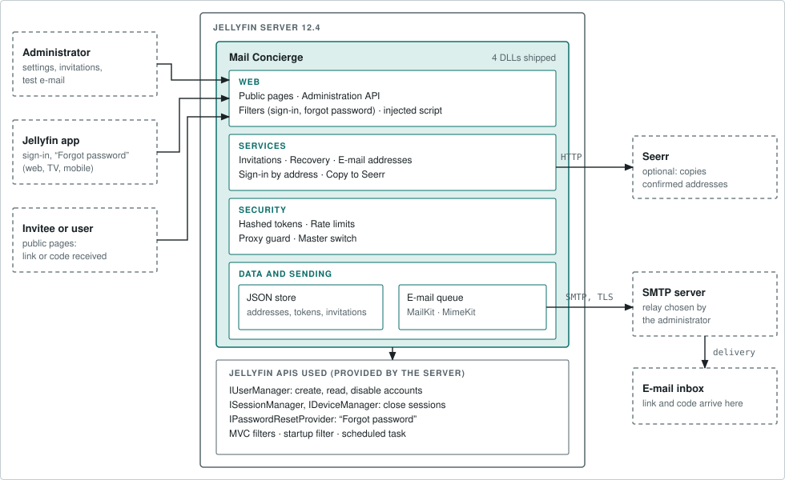
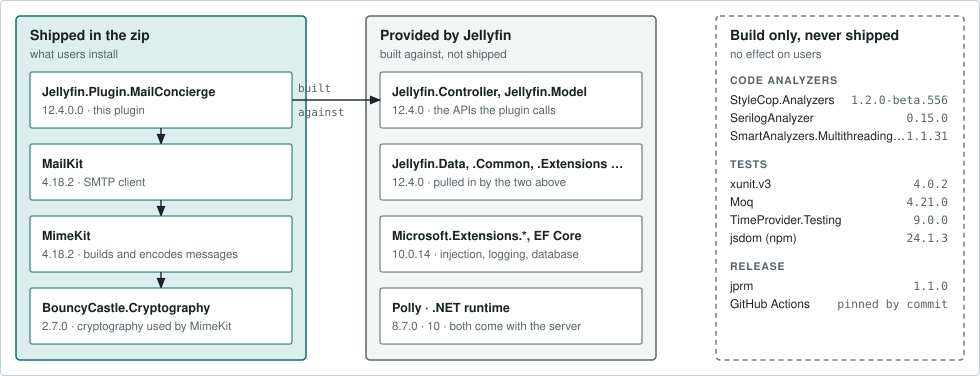

# Architecture

Back to the [README](../README.md).

Mail Concierge runs inside the Jellyfin server and changes nothing in Jellyfin itself. It creates and reads accounts only through Jellyfin's own APIs, and keeps its own data (addresses, hashed tokens, invitations) in a separate file.

## Dependencies

Only the first group travels to your server: the release zip holds four DLLs. The packages Jellyfin provides are compiled against but not shipped, and the build tools never leave the repository.

The packages and versions shown are those of release 12.4.0.0. The exact versions are in `Jellyfin.Plugin.MailConcierge/Jellyfin.Plugin.MailConcierge.csproj` and in the `packages.lock.json` files.
